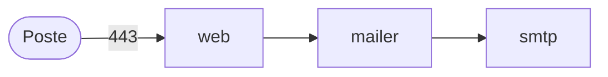
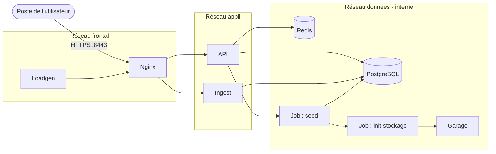

# Architecture cible de VéloCité sur Kubernetes

A FAIRE. Un croquis le lundi (atelier 1), la version finale le mercredi
(après l'atelier 5). Ce document se lit avant `DEPLOIEMENT.md` et
`RUNBOOK.md` : ce qui tourne, où, et pourquoi.

## Vue d'ensemble

Un schéma : les services, qui appelle qui, ce qui vient du poste. Lundi, un
croquis à partir de l'inventaire ; mercredi, les namespaces s'y ajoutent.

Le schéma s'écrit en Mermaid, un format texte que GitHub affiche comme un
dessin. Les flèches se génèrent à partir de la section 2 de l'inventaire,
depuis le dossier `app` :

Windows :

```powershell
$c = docker compose --profile "*" config --format json | ConvertFrom-Json
foreach ($s in $c.services.PSObject.Properties) {
  foreach ($d in $s.Value.depends_on.PSObject.Properties) {
    "  {0} --> {1}" -f $s.Name, $d.Name } }
```

macOS et Linux :

```bash
docker compose --profile "*" config --format json | jq -r '.services | to_entries[]
  | .key as $s | (.value.depends_on // {}) | keys[] | "  \($s) --> \(.)"'
```

Collez les lignes sous `flowchart LR`, puis ajoutez ce que les dépendances ne
disent pas : le poste qui appelle nginx sur 8443, les trois réseaux
(`docker compose config --networks`). Exemple de forme, sans rapport avec
VéloCité :



Votre schéma :



## Les layers d'infrastructure

| Layer | Dossier | Ce qu'il crée | Fréquence |
|---|---|---|---|
| | | | |

## Les deux environnements

| | dev | prod |
|---|---|---|
| Namespace | `velocite-dev` | `velocite-prod` |
| Point d'entrée HTTPS local | `https://localhost:8443` | `https://localhost:9443` |
| NodePort nginx | `30443` | `30444` |
| API | Une copie fixe | HPA : de 2 à 4 copies selon le CPU |
| Ingest et nginx | Une copie chacun | Deux copies chacun |
| Protection des interruptions | La stratégie de rollout évite la coupure | Même stratégie, plus un PDB pour API, ingest et nginx |
| Configuration de l'API | `VELOCITE_ENV=dev` | `VELOCITE_ENV=prod` |

Les deux environnements sont créés par la même couche OpenTofu `infra/20-env`,
mais dans deux workspaces distincts. Les overlays Kustomize partagent la base
`deploy/base` et ne portent que les différences d'environnement. Une version
est d'abord validée en dev avant que le tag de l'overlay prod ne soit modifié.

## Ce qui garde la plateforme durcie

- Chaque namespace impose le niveau Pod Security `restricted` : les pods
  doivent être non-root, sans élévation de privilèges ni capacités Linux
  ajoutées.
- Les conteneurs utilisent un système de fichiers racine en lecture seule,
  des limites et réservations de ressources, et un répertoire temporaire
  explicite lorsque nécessaire.
- Les secrets sont créés par OpenTofu et montés comme fichiers sous
  `/run/secrets`; aucun secret n'est écrit dans les manifests Kustomize.
- Une politique réseau par défaut refuse tous les flux. Les NetworkPolicies
  n'ouvrent que le DNS et les communications nécessaires entre services.
- Les sondes de démarrage, de disponibilité et de vivacité retirent un pod
  non prêt du trafic et relancent un processus bloqué.
- Les mises à jour des Deployments utilisent `maxSurge: 1` et
  `maxUnavailable: 0` : l'ancienne révision reste disponible tant que la
  nouvelle n'est pas prête.

## La supervision

Prometheus collecte les métriques des services annotés et du client témoin ;
celui-ci mesure les réponses reçues, donc les pannes réseau et les 5xx que la
seule santé des pods ne révèle pas. Les règles d'alerte et d'enregistrement
sont des fichiers versionnés puis fournis à Prometheus par OpenTofu.

Grafana reçoit le même Prometheus comme source de données. Son tableau
VéloCité est un JSON du dépôt injecté par ConfigMap : les panneaux restent
reproductibles lors d'une reconstruction. L'alerte associe un résumé, une
sévérité et une ancre de runbook ; Alertmanager n'a volontairement pas de
canal de notification dans cet exercice, les alertes sont lues dans son
interface.

## Les choix et ce qu'on a écarté

| Choix | Écarté | Pourquoi |
|---|---|---|
| | | |

## Ce qui reste hors périmètre
